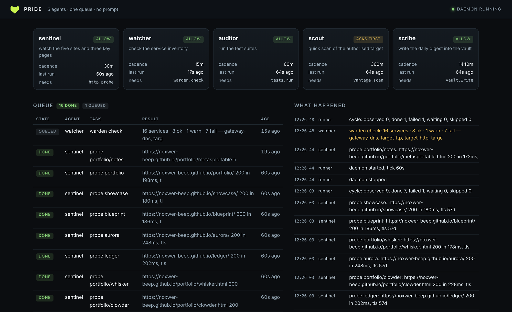

# pride

A supervised pack of agents that runs on a **cadence, not a prompt**.

Five small agents, one queue, one policy file. It watches the five sites, checks the
homelab, runs the five test suites, scans the authorised target, and writes a daily
digest — on a schedule, unattended, with a log you can read in the morning.

```
 /\_/\      PRIDE  1.0.0
( o.o )     five agents, one queue, no prompt
 > ^ <      daemon running

AGENT      DOES                                       CADENCE   LAST RUN   STATE
sentinel   watch the five sites and three key pages   30m       2m ago     allow
watcher    check the service inventory                15m       2m ago     allow
auditor    run the test suites                        60m       2m ago     allow
scout      quick scan of the authorised target        360m      never      asks first
scribe     write the daily digest into the vault      1440m     26m ago    allow
```



## Why not a chat loop

Because the work is not conversational. "Are the sites up", "do the tests still pass",
"has the target changed" — those are questions with a schedule, not a question you want
to type forty times a day. What makes them safe to automate is not intelligence, it is
**bounded authority**: a fixed list of actions, a policy file that says which ones may
run while nobody is watching, and a log of every decision.

Pride is deliberately not clever. The agents are deterministic: run Warden, read its
verdict, compare, file it. The one thing they will not do is improvise a new kind of
action, because every action has a name in the policy file and an unlisted name is
refused.

## The five agents

| agent | cadence | what it does | policy action |
|---|---|---|---|
| **sentinel** | 30m | probes 5 sites + 3 key pages: status, latency, TLS days left | `http.probe` |
| **watcher** | 15m | runs Warden, parses the verdict, names the failing services | `warden.check` |
| **auditor** | 1h | runs the test suite in each of the 5 repos, records the count | `tests.run` |
| **scout** | 6h | quick Vantage scan of the authorised target — **asks first** | `vantage.scan` |
| **scribe** | 24h | writes `Pride digest <date>.md` into the vault from the event log | `vault.write` |

## The policy is the safety model

```toml
# ~/.config/pride/policy.toml
dry_run = false
authorized = ["10.10.20.101"]

[actions]
allow            = ["warden.check", "http.probe", "tests.run", "vault.write"]
require_approval = ["vantage.scan"]
forbid           = ["git.push", "shell.any"]
```

Three decisions, and the defaults are the timid ones:

- **an unlisted action is refused**, not allowed — an agent cannot grow a new capability
  by being creative;
- **`forbid` beats `allow`**, even if a name appears in both;
- **scanning is `require_approval`** by default, and even then the target must be in
  `authorized` *and* in the Vantage scope file, or scout refuses.

When an action needs approval the task is parked, shown by `pride approvals` and on the
dashboard, and it does not move until you say `pride approve <id>`. A refusal sticks: a
rejected task never runs.

## Install and run

```bash
pip install "pride[ui]"          # or ./pride from a checkout
pride init                       # write ~/.config/pride/policy.toml
pride cycle --dry-run            # see what it would do, queue untouched
pride cycle                      # one pass
pride status                     # what it is doing, and what it just did
pride web                        # dashboard on :8790
```

As a service, so it survives logout and reboot:

```bash
./deploy/install-service.sh      # systemd --user, no root
systemctl --user status pride
journalctl --user -u pride -f
```

The unit caps it at 512 MB and 50% CPU: an unattended loop should not be able to become
the problem.

## Commands

```
pride                      what the pack is doing (default)
pride status --json        the same, machine-readable
pride cycle [--only X] [--dry-run]
pride daemon [--interval 60]
pride approvals            what is waiting for you
pride approve <id> | pride reject <id>
pride policy               what may run unattended, and why
pride tasks --state failed
pride events --level warn
pride doctor
```

Exit codes: `0` ok · `1` error · `2` usage · `3` missing dependency · `4` something is
failing (a cycle had failures, or approvals are waiting).

## What the loop guarantees

- **A crash never loses work.** Tasks are claimed in the database before they run, and
  anything left `running` after a restart is put back in the queue.
- **A task cannot run twice at once.** Fingerprints dedupe open work; the queue is the
  only place a decision lives.
- **Failures are visible.** Three attempts, then `failed` with the reason; the dashboard
  and `pride events --level warn` both show it.
- **Silence is meaningful.** A cycle only writes a log line when something happened, so
  an empty log means "nothing to report", not "nothing ran".

## Limits, honestly

- **It does not think.** No LLM is involved: these agents run checks and compare numbers.
  That is the point — a thing that acts every 15 minutes without supervision should be
  predictable, and an unpredictable one should not have a root-free path to your tools.
- **It cannot fix anything.** It detects, records, and asks. Remediation is a human
  decision in this design.
- **Approvals are a queue, not a notification.** Today you see them in `pride status`
  and on the dashboard; wiring them into a phone notification is the obvious next step.
- **Scout's scan is `quick`** (top 100 ports), not the deep `standard` profile — six
  times a day of full scans would be noise, and drift detection is the job.

## Tests

```bash
python3 -m unittest discover -s tests -t .
```

50 tests, no network needed. They use a real local HTTP server for probing, real shell
scripts as stand-in tools, a real SQLite queue, and a temp vault — including the cases
that matter most: a forbidden action must not run, an unapproved one must wait, a
rejected one must never run, a dry run must not consume the queue, and **zero open ports
on a target must not be reported as success** (that bug is in the history: a switched-off
Metasploitable box looked exactly like a clean one until the agent was taught the
difference).

## Licence

MIT. Nothing leaves the machine unless you allow it.
